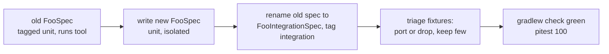

# Design

## Context

See `proposal.md` for the motivation. The constraints that shape the approach:

- Both modules already split tests by tag: `test` runs `unit`, `integrationTest` runs `integration`,
  `check` depends on both, and Pitest's `includedGroups` is `['unit']`. Only the labels are wrong, so
  the build wiring needs no change.
- Pitest runs at 100/100/100 and is the project's proof of completeness. 22 of the 24 specifications
  are tagged `unit` only so that Pitest sees them.
- Every rule is a thin visitor over a set of small package-private `@VisibleForTesting` methods,
  which exist so that a test can spy the rule and stub its siblings. `ImportRulePredicatesSpec` and
  `VisitDelegationSpec` already work this way.
- The CodeNarc rules share helper classes (`MockFactories`, `MockCall`, `DoubleScope`,
  `SpockInteraction`, `AbstractSpockRule`, `AbstractSpockBlockVisitor`) that no specification tests
  directly today.
- `codenarc-rules` analyses its own specifications with its own strict ruleset, and a violation there
  is fixed in the specification, never by excluding a rule.
- `spock-deepmock` is already in the `dependencies` platform. Its transformation is global: it
  rewrites `DeepMock(...)` to `Mock(...)` and also wraps the receiver of every interaction statement
  (`1 * repo.save(x)`, `repo.find() >> y`) in any Groovy compiled while the jar is on the classpath.
  Without the jar, CodeNarc sees neither rewrite. This is why the archived migration left `DeepMock`
  off `codenarc-rules`' test classpath: 35 rule specs broke.
- `codenarc-rules` has no `byte-buddy` or `mockito-core` on its test classpath today, although
  `build-foundation` requires both modules to have them.

## Goals / Non-Goals

**Goals:**
- A test's tag says what it does. Pitest selects the specifications that prove completeness and no
  others.
- Every rule class and helper class has a unit specification that reads as the specification of that
  class.
- No Groovy source in a string anywhere in the test sources.
- The migration lands one rule at a time, green at every step.

**Non-Goals:**
- Changing Pitest's thresholds, its `includedGroups`, or the `test` / `integrationTest` wiring.
- Removing the `@VisibleForTesting` seams from the rules. The unit layer depends on them.
- Recognising `GroovyMock`, `GroovyStub`, `GroovySpy` or `GroovyDeepMock`. That gap predates this
  change and stays.
- Changing what any PMD rule reports. Only `codenarc-rules` changes behaviour, and only for `DeepMock`.

## Decisions

### 1. Pitest selects only `unit`; integration specifications are outside it

Unit specifications must kill every mutant on their own. This is the stricter choice and the one
asked for: the unit layer is the source of truth for completeness, so a gap in it must fail the build
and must not be masked by a fixture that happens to exercise the line.

*Alternative: Pitest selects both tags.* Fixtures would kill the behavioural mutants and the unit layer
could be selective. It would make the integration layer part of the completeness argument, which it
cannot carry: it is deliberately not exhaustive. It would also put a PMD or CodeNarc start-up on the
mutation path.

*Alternative: a separate `integrationTest` source set.* It would enforce the split structurally. It
adds build complexity to solve a problem the tag plus a naming convention already solves once the tags
are honest.

### 2. Two specifications per rule, named for what they test

`FooSpec` is the unit specification of class `Foo`; `FooIntegrationSpec` runs the rule `Foo` through
the real tool. Helper classes get a `Spec` only. The distribution specifications
(`RulesetDistributionSpec`, `StrictRulesetDistributionSpec`) are integration tests already and keep
their tag; they are renamed only if the convention requires it.

The name tells a reader which layer a failure is in before opening the file, and lets a rename-based
migration step carry the old specification into its new role.

### 3. Fixtures: few, as files, one violating sample each

PMD keeps `.java` files under `src/test/resources`. CodeNarc gets `.groovy` files in the same place,
outside every source set. The per-module runner (`PmdRuleRunner`, and a CodeNarc counterpart with the
same shape) returns violation lines, and an integration specification asserts them.

Each existing PMD fixture is triaged once:

| The case shows | Disposition |
|---|---|
| a decision in the rule's own code | becomes a unit case; the fixture is deleted |
| PMD's behaviour (suppression, language level declared in the ruleset, counts per file) | dropped, except one language-level case which only the real PMD can show |
| a surprising fact about the tool's model that the rule depends on | kept as an integration fixture and named for the fact |

*Alternative: marker comments (`// violation`) with expected lines derived from the fixture.* Worth it
for dozens of cases per rule. With one to three fixtures per rule a line table in the specification is
simpler and adds no convention.

### 4. Unit specifications isolate with `Mock`, `Spy`, `DeepMock` and `SpyStatic`

- A rule's method is tested by spying the rule, stubbing the sibling methods it calls, and verifying
  the interactions it drives. This is the style of the existing `VisitDelegationSpec`.
- In `pmd-rules`, a chain of nested nodes is one `DeepMock()`, per the existing requirement. PMD
  fixtures are Java, which the Groovy transformation never touches.
- In `codenarc-rules`, `DeepMock` is not used (decision 5). A Groovy AST node that is plain data is
  built as a real node (`new TupleExpression(new MapExpression(...))`), and a node whose state a test
  cannot build is a `Mock` or `Stub`.
- A static helper of a framework we depend on (`SpockUtil`, PMD's helpers) is stubbed with `SpyStatic`,
  declared with the unlabelled setup statements because that is where `AvoidSpyStaticInLabelledBlock`
  requires it.
- A JDK static (`Character.isUpperCase`) is not stubbed. It is a function of its arguments, and
  Mockito restricts static mocking of some JDK classes.
- Strict mocking, typed declarations and `0 * _` apply, because the specifications are dogfooded.

The repetitive "reports / reports nothing / returns its data" trio per rule is extracted into a shared
pattern within each module once the PMD pilot shows its shape, rather than copied eight and fourteen
times.

### 5. `codenarc-rules` does not get `spock-deepmock`

The transformation would rewrite interaction targets in every fixture the integration layer parses in
the same JVM, so the rules would analyse a different AST from the one a consumer's CodeNarc sees.
That would defeat the purpose of a smoke test. `codenarc-rules` instead gains `byte-buddy` and
`mockito-core` on its test classpath so that `Mock(Class)` and `SpyStatic` work, and its unit
specifications use real nodes where a node is just data.

*Alternative: `DeepMock` in both modules, with `integrationTest` running on a classpath that filters
the jar out.* The compiled specifications reference the jar, so the filtered run is fragile. The clean
version is a separate `integrationTest` source set, which adds build structure for the sake of one
dependency.

Building real nodes is also what the classes read: `MockCall` reads `TupleExpression`,
`MapExpression` and `PropertyExpression`, all constructible without a parser or a source string.

### 6. Migration is one atomic step per rule

Between B and C both specifications are tagged `unit` for one commit's worth of work at most; the
step is merged only at E. The build never goes red because the old specification keeps Pitest at 100%
until the new one carries it. A rule is finished when its new unit specification alone holds Pitest
at 100%, which is the check that the integration specification is no longer propping it up.

PMD goes first as the pilot because it has eight rules and a mock-based precedent. A review
checkpoint follows it, where the pattern from decision 4 is settled, before the fourteen CodeNarc
rules.

### 7. `DeepMock` joins the shared factory list, test-first

`MockFactories` gets its unit specification before anything changes. `DeepMock` is then added to its
exact-name set, and `AvoidMockInitializerClosureRule` stops carrying a private copy of the list and
reads `MockFactories` instead.

Names are matched exactly (`equals`), which is why `SpyStatic` was never a factory. That is now
specified and tested. `DeepMock` is a mock, not a stub or a spy, so `MockCall.isSpy` and
`isUnverifiedStub` do not claim it and the stub and spy rules are unaffected.

*Alternative: rely on the library's rewrite.* The rewrite exists only when `spock-deepmock` is on the
classpath of the compiler CodeNarc uses. A consumer's `codenarc` configuration does not normally have
it, and the rules would then behave differently depending on how a consumer wired their tool.

### 8. Commit routing

release-please routes by path. The `DeepMock` change touches `codenarc-rules/src/main`, so it is a
`feat(codenarc-rules)` commit and cuts a release. Everything else is `test(pmd-rules)`,
`test(codenarc-rules)` or `chore`, and cuts none. The two kinds are never mixed in one commit.

## Risks / Trade-offs

- **Mocks encode our assumptions about the tools' AST, and nothing checks them** → The integration
  specification is the check, and fixtures are kept wherever a rule depends on a surprising fact about
  the tool's model (the enum-constant body in `AvoidAnonymousClasses`). Accepted: it covers the
  happy path only.
- **The mocking approach does not work on Groovy 5 or on these node types** (`SpyStatic` on a Groovy
  class called from Java, mocks of final PMD nodes, `DeepMock` over `NodeStream`, `Mock` of Groovy AST
  classes and real-node construction, all under Pitest's JUnit 5 plugin) → The first task is a spike
  for each. A failure stops the change and is reported before any rule is migrated.
- **Chained `DeepMock` interaction targets may confuse the interaction rules**, since
  `1 * person.address.city >> 'x'` is a longer receiver, and a consumer who puts `spock-deepmock` on
  CodeNarc's classpath gets receivers wrapped in `endWalk(beginWalk(...), …)` → The spike runs the
  interaction and spy rules over both source shapes and records what they report. If a rule
  misreports, that is a scope change and goes back to the user.
- **Specifications that exist to kill mutants are brittle**, because they assert call structure →
  Accepted as the cost of 100% on the unit layer. Shared patterns (decision 4) and `@VisibleForTesting`
  seams that match real decisions keep them readable.
- **New specifications violate the strict ruleset** → The specification is fixed, never the ruleset.
- **The migration is large and reviewed by one person** → One rule per commit, each green, so review
  can stop and resume at any rule.

## Migration Plan

1. Spike the mocking approach (tasks 1).
2. Land the build and spec groundwork (tasks 2).
3. Migrate PMD rule by rule, then review the pattern (tasks 3).
4. Migrate CodeNarc helper classes, then rule by rule (tasks 4).
5. Add `DeepMock` test-first (tasks 5).
6. Run `./gradlew check` and commit (tasks 6).

Rollback is per commit: each step leaves the build green, so reverting a step restores the previous
specification and its Pitest coverage.

## Spike results (tasks 1)

- **1.1 pmd-rules: passes.** A `Mock()` of `ASTAnonymousClassDeclaration`, a `DeepMock()` whose
  `getBody().descendants(ASTMethodDeclaration).toList()` chain is stubbed through the `NodeStream`
  call, and `SpyStatic(TypeTestUtil)` all work under `:pmd-rules:test` and `:pmd-rules:pitest`
  (the Pitest run finished at 100% with the spike present, 51 tests examined). Note for the specs: `SpyStatic` stubs of an overloaded static
  need a typed argument; `isA(Class, null)` is ambiguous between the `TypeNode` and `JTypeMirror`
  overloads.
- **1.2 codenarc-rules: passes.** A real `TupleExpression(MapExpression)`, `Mock()` of
  `ExpressionStatement` and `ClassNode`, and `SpyStatic(SpockUtil)` stubbing `isBooleanExpression`
  for a call made from a Java class work under `:codenarc-rules:test` and `:codenarc-rules:pitest`.
- **1.3 rules over `1 * person.address.city >> 'x'`** (`person` is `DeepMock()`, `service` is `Spy()`):

  | Rule | Plain source | With `spock-deepmock` on the classpath |
  |---|---|---|
  | `InteractionsBelongInThenBlock` | nothing | nothing |
  | `RequireSpyEntryInteraction` | line 14 `1 * service.run()` (add `1 * service._`) | nothing |
  | `RequireSpyInteractionResponse` | line 14 `1 * service.run()` (no `>>`) | nothing |
  | `AvoidCardinalityOnStub` | nothing (`person` is a mock, not a stub) | nothing |

  Plain source reports what the rules should. With `spock-deepmock` on the classpath, the two spy
  rules go silent on the same source: the rewrite wraps the receiver of `1 * service.run()`, and the
  rules no longer see a spy call. This is the misreport the Risks section anticipates. It does not
  change decision 5 (`codenarc-rules` stays off `spock-deepmock`), but it is a consumer-visible gap:
  a consumer whose CodeNarc classpath has `spock-deepmock` gets false negatives from these rules.
  Not isolated further (which part of the chain triggers it) and not fixed here.

## Agreed pattern (task 4.1, PMD pilot review)

- Each `@VisibleForTesting` method has its own unit feature group. The method under test is the spy's real
  method, and its siblings are stubbed. Nothing tests a method only through `visit`.
- `visit` has one unit feature: it stubs the report method with `>> {}` and checks that it returns its data.
  The report method has its own features, which stub the decision it calls.
- Every spy entry is followed by `1 * rule._` (CodeNarc `RequireSpyEntryInteraction`). Interactions
  with a wildcard argument are not allowed (`RequireValidatedInteractionArguments`), so expected values
  are passed as values, and collections the rule builds internally are passed as `[:]` or `[] as Set`.
- Streams that a rule iterates or filters are map-coerced to the declared PMD type (`[filter: { ... }] as
  NodeStream.DescendantNodeStream`), so their operations run the rule's own lambdas and no wildcard is
  needed. A list coerced to `NodeStream` stands in where only iteration is used.
- `@VisibleForTesting` methods that return a value are tested with a `where:` table, with interaction
  cardinality written as `(condition ? 1 : 0) * ...` so short-circuit evaluation is specified.
- The integration spec keeps the violating fixture, the fixtures for facts about PMD's model that the rule
  depends on, and the language-level case that only real PMD can show. Every other fixture is deleted, and
  its case becomes a unit feature.
- `VisitDelegationSpec` is retired: each rule's visit cases live in its unit spec.
